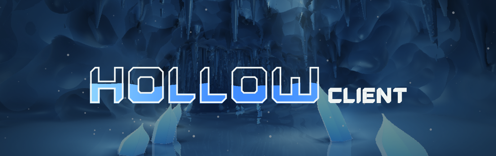
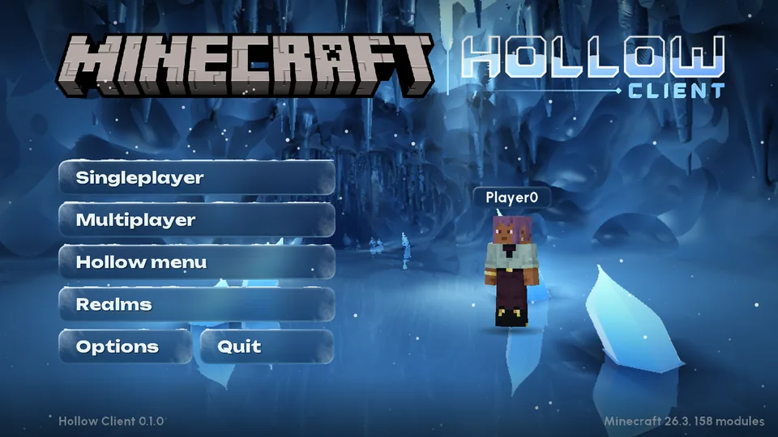
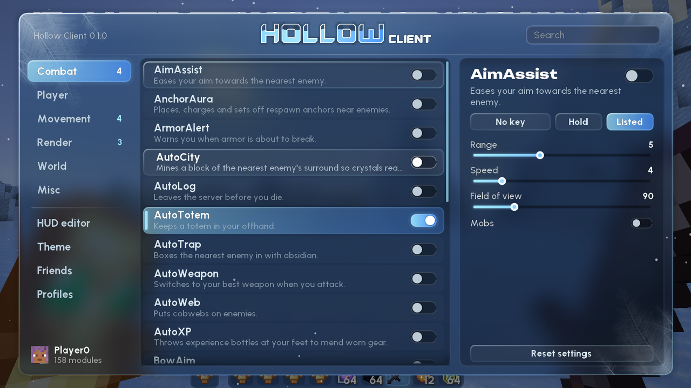
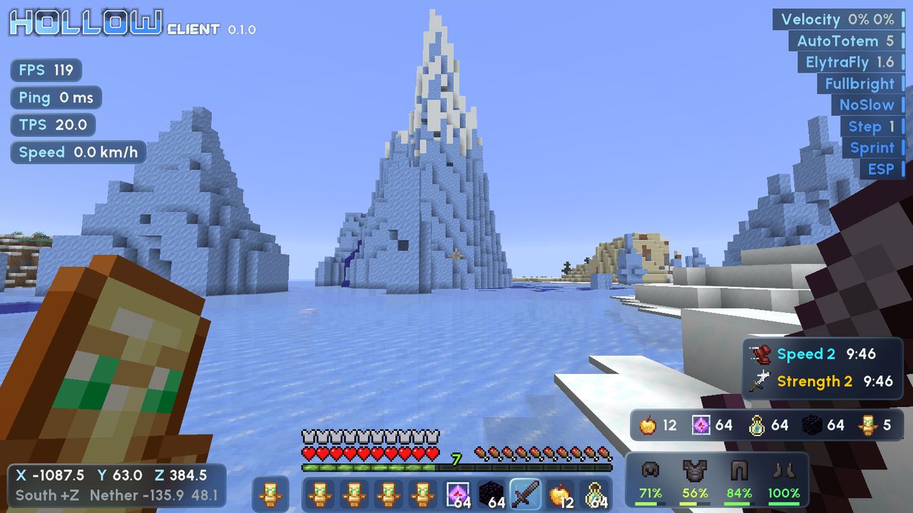
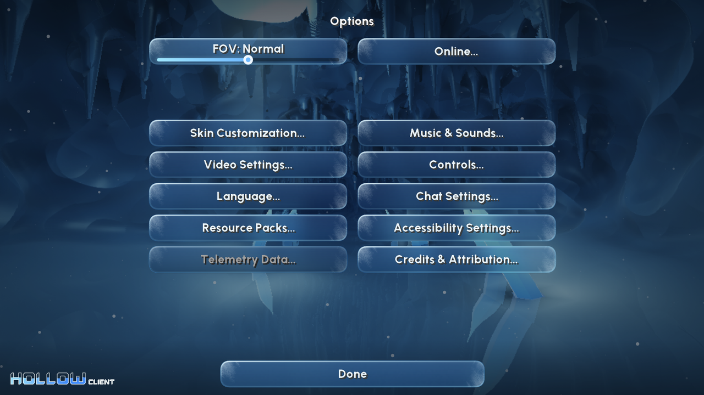
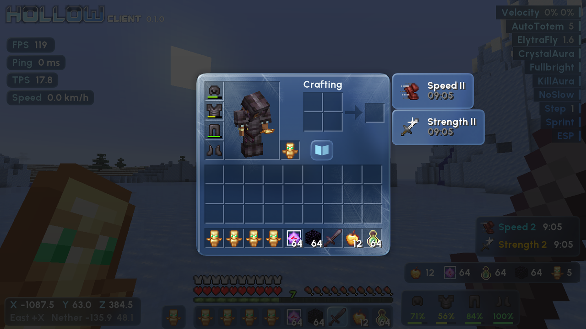
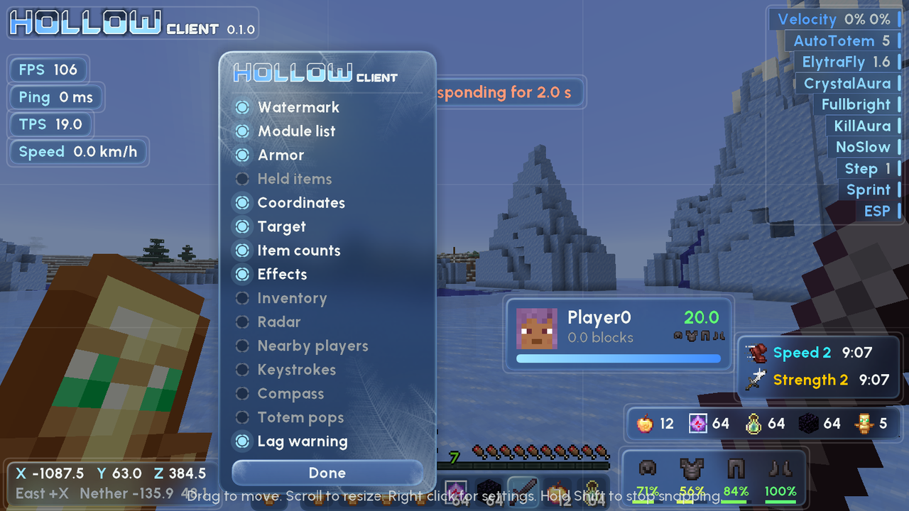
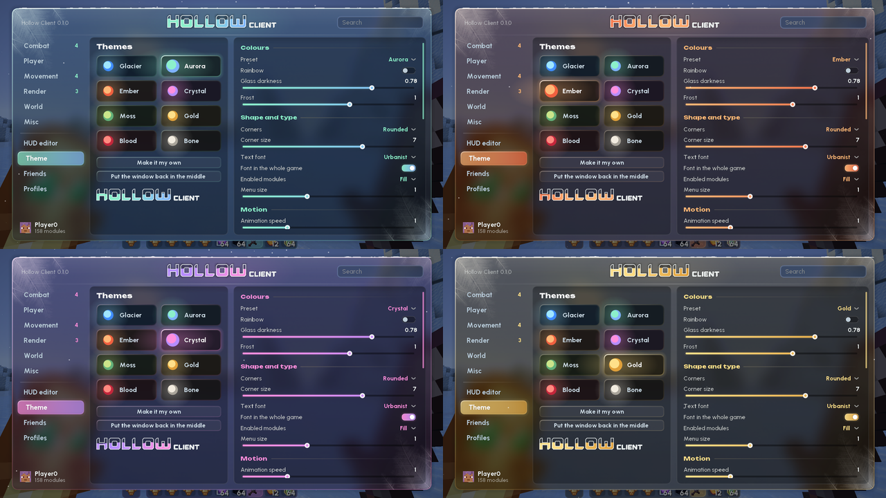

  

  <b>A PvP and schematic building client for anarchy servers, carved out of ice.</b>

  
  
  
  

  <a href="#install">Install</a> ·
  <a href="docs/GUIDE.md">Guide</a> ·
  <a href="docs/MODULES.md">All modules</a> ·
  <a href="CHANGELOG.md">Changelog</a> ·
  <a href="docs/BUILDING.md">Build it yourself</a>

---

Hollow Client is a Fabric mod for Minecraft 26.3. It has 158 modules and 36 HUD elements, a Litematica printer that places blocks the right way round, and an interface drawn from scratch: frosted glass panels over a ray-marched ice cavern.

Version 0.1.0 is the first polished release.

  

## Highlights

<table>
<tr>
<td width="50%"></td>
<td width="50%"></td>
</tr>
<tr>
<td valign="top"><b>One window for everything.</b> Categories on the left, modules in the middle, settings always open on the right. Search, key binds, hold-to-use, friends, themes and profiles are all in the same place.</td>
<td valign="top"><b>A HUD you arrange yourself.</b> Armor durability, module list, target, radar, totem pops, item counts and more. Drag, resize and restyle each one.</td>
</tr>
<tr>
<td></td>
<td></td>
</tr>
<tr>
<td valign="top"><b>The game's own screens too.</b> Buttons, sliders, lists, tabs, tooltips, pop-ups and the loading screen share one style. Every screen has its own chamber in the cavern.</td>
<td valign="top"><b>Glass inventories.</b> Chests, furnaces and your inventory become frosted panels with clear slots. The creative inventory keeps its normal look.</td>
</tr>
<tr>
<td></td>
<td></td>
</tr>
<tr>
<td valign="top"><b>HUD editor.</b> Elements snap to edges and to each other, and stay anchored when the window changes size.</td>
<td valign="top"><b>Eight themes.</b> Glacier, Aurora, Ember, Crystal, Moss, Gold, Blood and Bone, or pick your own colours.</td>
</tr>
</table>

## Install

You need Minecraft **26.3**, **Fabric Loader 0.19.5 or newer** and **Java 25**. Most launchers set up Java for you.

1. Install [Fabric](https://fabricmc.net/use/installer/) for Minecraft 26.3. In Prism Launcher, choose Fabric when you create the instance.
2. Download [Fabric API](https://modrinth.com/mod/fabric-api) for 26.3.
3. Download `hollow-client-26.3-0.1.0.jar` from [Releases](../../releases).
4. Put both jars in the `mods` folder.
5. Start the game. Press <kbd>Right Shift</kbd> in a world, or choose **Hollow menu** on the start menu.

For Printer and AutoBuild, also add [Litematica](https://modrinth.com/mod/litematica) and [MaLiLib](https://modrinth.com/mod/malilib) for 26.3. Everything else works without them.

The [full install guide](docs/INSTALL.md) covers Prism, the official launcher, updating, removing and common problems.

## First five minutes

| Do this | To |
| --- | --- |
| <kbd>Right Shift</kbd> | Open the menu |
| Left click a module | Switch it on or off |
| Right click a module | Show its settings without switching it |
| Middle click a module | Bind a key, then press the key. <kbd>Delete</kbd> clears it |
| Start typing | Search every module |
| `.help` in chat | List the commands. They are never sent to the server |

More in the [guide](docs/GUIDE.md): HUD editor, friends, profiles, waypoints and building a schematic.

## Modules

Every module is described with all its settings in [docs/MODULES.md](docs/MODULES.md).

<b>Combat</b> · 23

| Module | What it does |
| --- | --- |
| **AimAssist** | Eases your aim towards the nearest enemy. |
| **AnchorAura** | Places, charges and sets off respawn anchors near enemies. |
| **ArmorAlert** | Warns you when armor is about to break. |
| **AutoCity** | Mines a block of the nearest enemy's surround so crystals reach them. |
| **AutoLog** | Leaves the server before you die. |
| **AutoTotem** | Keeps a totem in your offhand. |
| **AutoTrap** | Boxes the nearest enemy in with obsidian. |
| **AutoWeapon** | Switches to your best weapon when you attack. |
| **AutoWeb** | Puts cobwebs on enemies. |
| **AutoXP** | Throws experience bottles at your feet to mend worn gear. |
| **BowAim** | Aims a drawn bow at the enemy nearest your crosshair. |
| **BowRelease** | Lets arrows go as soon as the bow is drawn far enough. |
| **Criticals** | Makes every hit a critical hit. |
| **CrystalAura** | Places and breaks end crystals where they hurt enemies most and you least. |
| **Hitboxes** | Makes players easier to hit. |
| **HoleFill** | Fills safe holes near enemies before they reach them. |
| **KeepDistance** | Stops you walking any closer to an enemy than your reach needs. |
| **KillAura** | Attacks whoever is in reach as soon as your weapon is ready. |
| **PopCounter** | Counts the totems players use and tells you when they die. |
| **SelfTrap** | Closes obsidian around and above you. |
| **Surround** | Walls your feet in with obsidian. |
| **TriggerBot** | Attacks whatever your crosshair is on when the weapon is ready. |
| **Velocity** | Reduces knockback from hits and explosions. |

<b>Player</b> · 25

| Module | What it does |
| --- | --- |
| **AntiAFK** | Moves a little so you aren't kicked for idling. |
| **AntiHunger** | Hides sprinting from the server so you get hungry more slowly. |
| **AutoArmor** | Wears the best armor you are carrying. |
| **AutoClicker** | Clicks for you. |
| **AutoDrop** | Throws away items you don't want. |
| **AutoEat** | Eats when you are hungry or hurt. |
| **AutoFish** | Reels in and casts again when something bites. |
| **AutoMount** | Gets on the nearest mount. |
| **AutoPot** | Splashes healing potions on yourself when hurt. |
| **AutoRespawn** | Respawns without the death screen. |
| **AutoSleep** | Uses a bed in reach at night. |
| **AutoTool** | Holds the fastest tool for the block you are mining. |
| **ChestSwap** | Swaps between elytra and chestplate, then switches off. |
| **FakePlayer** | Stands a copy of you in the world to practise on. Only you see it. |
| **FastBreak** | Removes the pause between breaking blocks. |
| **FastUse** | Shortens the wait between right clicks. |
| **FullAlert** | Tells you when your inventory is full. |
| **MiddleClick** | Middle click adds friends or throws a pearl. |
| **Multitask** | Lets you mine while eating or using an item. |
| **NoInteract** | Stops you opening or rotating things by accident. |
| **NoRotate** | Keeps your view when the server tries to turn you. |
| **Offhand** | Keeps crystals or golden apples in the offhand when a totem is not needed. |
| **Reach** | Lets you reach further. Most servers allow only a little. |
| **Replenish** | Tops up hotbar stacks from your inventory. |
| **XCarry** | Keeps items in your crafting grid when you close the inventory. |

<b>Movement</b> · 35

| Module | What it does |
| --- | --- |
| **AirJump** | Jump again in mid-air. |
| **AntiLevitation** | Ignores levitation. |
| **AntiVoid** | Bounces you back up before the void takes you. |
| **AutoElytra** | Opens your elytra when you fall. |
| **AutoJump** | Jumps whenever you land. |
| **AutoWalk** | Keeps walking forward. |
| **Blink** | Holds your movement back, then sends it all at once. Short hops only. |
| **BoatFly** | Flies the boat you are in. |
| **ClickTP** | Sneak and right click a block to jump to it. Short hops only on most servers. |
| **ElytraBoost** | Uses fireworks to keep your elytra fast. |
| **ElytraFly** | Steers an open elytra with the movement keys. Jump climbs, sneak drops. |
| **EntitySpeed** | Rides horses, pigs and the rest faster. |
| **FastClimb** | Climbs ladders and vines faster. |
| **FastSwim** | Moves faster in water and lava. |
| **Flight** | Lets you fly. Strict servers will pull you back. |
| **HighJump** | Jumps higher. |
| **HoleSnap** | Pulls you into the nearest safe hole, then switches off. |
| **IceSpeed** | Runs faster on ice. |
| **InvMove** | Walk about with a menu open. |
| **Jesus** | Walk on water and lava. |
| **LongJump** | Pushes you forward when you jump. |
| **NoFall** | Prevents fall damage. |
| **NoJumpDelay** | Jump again the moment you land. |
| **NoPush** | Players, blocks and water can't push you. |
| **NoSlow** | Keeps full speed while eating, drinking or blocking. |
| **NoWeb** | Cobwebs, berry bushes and the like don't slow you. |
| **Parkour** | Jumps at the very edge of blocks. |
| **ReverseStep** | Drops straight down when you walk off a block. |
| **SafeWalk** | Stops you walking off edges. |
| **Sneak** | Keeps sneaking. |
| **Speed** | Moves you faster. |
| **Spider** | Climbs any wall you walk into. |
| **Sprint** | Always sprints. |
| **Step** | Walks straight up full blocks. |
| **YawLock** | Keeps you facing straight, for highways. |

<b>Render</b> · 36

| Module | What it does |
| --- | --- |
| **Ambience** | Changes the time of day for you only. |
| **BlockESP** | Finds the blocks you pick and shows them through walls. |
| **BlockOutline** | Outlines the block you point at, gliding from one to the next. |
| **BreakESP** | Shows the blocks others are mining. |
| **CameraTweaks** | Sets how far the third person camera sits and lets it pass walls. |
| **ChunkBorders** | Outlines the chunk you are in. |
| **CityESP** | Shows the surround blocks of enemies that can be mined. |
| **Crosshair** | Your own crosshair. |
| **DamageNumbers** | Damage and healing float up from whoever it happened to. |
| **ESP** | Draws boxes around players and more, through walls. |
| **Freecam** | Flies the camera away while you stand still. |
| **Freelook** | Look around without turning. |
| **Fullbright** | Lights up the dark. |
| **Glow** | Outlines players and more through walls. |
| **HandView** | Moves and resizes the items in your hands. |
| **HitMarker** | Marks your hits at the crosshair. |
| **HoleESP** | Marks safe holes near you. |
| **HUD** | Shows the HUD. Arrange it on the HUD page. |
| **ItemESP** | Shows dropped items and what they are. |
| **JumpRings** | A ring spreads from under you when you jump. |
| **LightOverlay** | Marks floors dark enough for monsters. |
| **LogoutSpots** | Marks where players were when they left the server. |
| **LookLines** | Shows where other players are looking. |
| **Nametags** | Bigger name tags with health, gear and ping. |
| **NoRender** | Hides things that get in the way. |
| **PlayerArrows** | Arrows point to players who are off screen. |
| **PopEffects** | Rings burst out when someone uses a totem. |
| **Snowfall** | Gentle snow around you, wherever you are. |
| **StorageESP** | Shows chests, shulkers and other storage through walls. |
| **TargetRing** | A ring travels up and down the nearest enemy. |
| **Tracers** | Draws lines to players and more. |
| **Trail** | Leaves a line where you have been. |
| **Trajectories** | Shows where arrows, pearls and potions will land. |
| **VoidESP** | Marks gaps in the bedrock floor. |
| **Waypoints** | Shows saved places. Type .waypoint add and a name to save one. |
| **Zoom** | Zooms in while you hold the key. |

<b>World</b> · 21

| Module | What it does |
| --- | --- |
| **AirPlace** | Places blocks in mid-air where the server allows it. |
| **AutoBreed** | Feeds animals so they breed. |
| **AutoBuild** | Walks around the schematic so Printer can finish it. |
| **AutoDoor** | Opens wooden doors in front of you and shuts them behind. |
| **AutoFarm** | Harvests ripe crops and plants them again. |
| **AutoNametag** | Puts name tags on mobs. |
| **AutoShear** | Shears sheep. |
| **AutoSign** | Writes signs for you as you place them. |
| **AutoTorch** | Puts a torch at your feet when it gets dark. |
| **AutoTunnel** | Digs a tunnel the way you are facing. |
| **BoneMealer** | Bone meals saplings and plants around you. |
| **ChestStealer** | Empties or fills chests you open. |
| **Flamethrower** | Sets monsters near you on fire with flint and steel. |
| **LiquidFill** | Fills liquids around you with blocks. |
| **Nuker** | Breaks blocks around you. |
| **Printer** | Places the blocks of your Litematica schematic as you walk near them. |
| **Scaffold** | Places blocks under your feet. |
| **SpawnProof** | Covers dark floors so nothing spawns there. |
| **StashFinder** | Tells you about chunks full of chests and saves them to the log. |
| **Timer** | Runs the game faster or slower. |
| **VeinMiner** | Mines the rest of a vein or tree after you break one block. |

<b>Misc</b> · 18

| Module | What it does |
| --- | --- |
| **AutoMessage** | Says something now and then. Check that the server allows it. |
| **AutoReconnect** | Joins again after you are disconnected. |
| **BetterTab** | More players and real ping in the player list. |
| **BrandSpoof** | Tells servers you use another client. |
| **ChatTag** | Adds Hollow Client to the end of your chat messages. |
| **ChatTimes** | Shows when each chat message arrived. |
| **DeathSpot** | Remembers where you died. |
| **FriendAlert** | Tells you when friends join or leave the server. |
| **LagBack** | Tells you when the server pulls you back. |
| **Macro 1** | Sends a message or /command when you press its key. |
| **Macro 2** | Sends a message or /command when you press its key. |
| **Macro 3** | Sends a message or /command when you press its key. |
| **Mentions** | Plays a sound when someone says your name or words you choose. |
| **NoToasts** | Hides the game's own pop-ups, such as advancements. |
| **Panic** | Switches every module off at once. |
| **PearlAlert** | Tells you when someone throws an ender pearl and which way. |
| **SoundFilter** | Mutes sounds that get annoying. |
| **VisualRange** | Tells you when players come into view. |

<b>HUD elements</b> · 36

| Element | What it does |
| --- | --- |
| **Watermark** | The Hollow Client name. |
| **Module list** | Modules that are on, sliding in and out. |
| **Armor** | Worn armor with durability. |
| **Held items** | What you hold, with count and durability. |
| **Coordinates** | Where you are, and the matching place in the Nether or Overworld. |
| **Target** | Health and gear of whoever you are fighting. |
| **Item counts** | How many of the items you pick you are carrying. |
| **Effects** | Active effects and the time left on them. |
| **Inventory** | Your inventory at a glance. |
| **Radar** | A small map of who is around. |
| **Nearby players** | Players you can see, with distance and health. |
| **Keystrokes** | The movement keys and clicks you are pressing. |
| **Compass** | A strip showing which way you face. |
| **Totem pops** | Totems the players around you have used up. |
| **Lag warning** | Shows when the server stops answering. |
| **Your text** | Any words you like. |
| **Key list** | Modules with a key, and whether they are on. |
| **Speed** | How fast you are moving. |
| **FPS** | Frames per second. |
| **Ping** | Delay to the server. |
| **TPS** | How fast the server is running. 20 is full speed. |
| **Clock** | The time where you are. |
| **Server** | The server you are on. |
| **Session** | Time since you joined. |
| **Biome** | The biome you are in. |
| **World day** | Days passed in the world. |
| **Facing** | Direction and angle. |
| **CPS** | Your clicks per second. |
| **Combo** | Hits landed without being hit. |
| **Memory** | Memory the game is using. |
| **Saturation** | Hidden hunger reserve. |
| **Light** | Block light at your feet. Monsters need 0. |
| **Hole** | Whether you are standing in a safe hole. |
| **Players online** | Players on the server. |
| **Elytra** | Durability left on your elytra. |
| **Welcome** | Your name. |

## Building schematics

1. Load a schematic in Litematica and place it.
2. Carry the blocks. Printer takes them from the hotbar and your inventory.
3. Switch on **Printer** and walk near the build. Printer places missing blocks bottom up, follows Litematica's layer range and never breaks anything.
4. Switch on **AutoBuild** to have it walk there for you.

In the automated test, with 27 other mods loaded, both rebuild a 19 block structure exactly. It includes stairs, slabs, logs, doors, a piston, a dispenser, a repeater and a wall torch.

## Compatibility

- Tested together with Sodium, Iris, Litematica and Mod Menu.
- Client side only. The server does not need it.
- The cavern has three detail levels and can be switched off, and so can every restyled screen. See **Theme** in the menu.

## Fair warning

Hollow Client is for anarchy servers, where clients like this are allowed. Other servers will ban you for it, so check the rules first. It has not been tested against the anticheat of any particular server, and strict ones will reject some movement modules.

It does not read or touch account data, has no telemetry and contains no exploits that crash servers or other players. Friends are never targeted.

Hollow Client is not affiliated with Mojang, Microsoft or any server.

## Licence

Copyright 2026, all rights reserved. See [LICENSE](LICENSE). The bundled fonts are under the SIL Open Font License, listed in [THIRD_PARTY.md](THIRD_PARTY.md).
