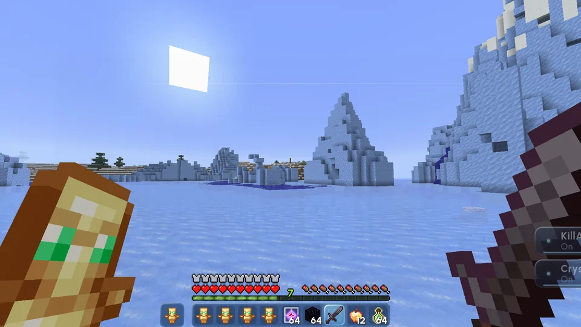
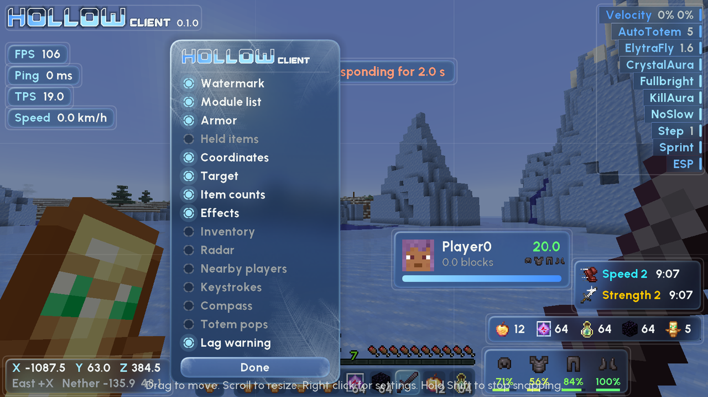

# Guide

- [The menu](#the-menu)
- [Keys](#keys)
- [HUD editor](#hud-editor)
- [Themes and motion](#themes-and-motion)
- [Friends](#friends)
- [Profiles](#profiles)
- [Commands](#commands)
- [Building a schematic](#building-a-schematic)
- [Where settings are kept](#where-settings-are-kept)

## The menu

<kbd>Right Shift</kbd> opens it in a world. On the start menu, choose **Hollow menu**.

| Part | What it does |
| --- | --- |
| Left | Categories, with the number of modules that are on. Below them: HUD editor, Theme, Friends and Profiles |
| Middle | The modules of the category, or the search results |
| Right | The settings of the selected module |

| Input | Effect |
| --- | --- |
| Left click a module | On or off |
| Right click a module | Select it and show its settings |
| Middle click a module | Bind a key |
| Type | Search all modules. <kbd>Esc</kbd> clears the search |
| Drag the header | Move the window |

Middle click a setting to put it back to its default. **Reset settings** does that for the whole module.

## Keys

Middle click a module, or use the key button in its settings, then press the key you want. <kbd>Delete</kbd> or <kbd>Backspace</kbd> clears it.

**Hold** keeps the module on only while the key is down, which suits Zoom, Freelook and Freecam. **Listed** decides whether the module shows in the HUD's module list.

## HUD editor

| Input | Effect |
| --- | --- |
| Drag | Move an element. It snaps to edges, the middle and other elements |
| <kbd>Shift</kbd> while dragging | No snapping |
| Scroll | Resize |
| Right click | Settings |
| Arrow keys | Move the selected element by one step |

## Themes and motion

**Theme** in the menu holds eight colour presets and the rest of the look:

- accent colours, glass darkness, frost and corner shape
- font, and whether it is used in the whole game
- menu size and animation speed. **Reduce motion** turns most animation off
- the start menu scene, cavern detail, snowfall and your skin
- which of the game's own screens are restyled

## Friends

Add friends on the Friends page, with `.friend add <name>`, or with the MiddleClick module. No module targets a friend.

## Profiles

A profile stores every module, setting, key and HUD position under a name. Make one for each server or kit and switch on the Profiles page.

## Commands

Commands start with a dot and stay on your computer.

| Command | Effect |
| --- | --- |
| `.help` | Lists the commands |
| `.toggle <module>` or `.t` | Switches a module |
| `.bind <module> <key>` | Binds a key. Use `none` to unbind |
| `.friend add`, `remove` or `list` | Manages friends |
| `.waypoint add`, `remove` or `list`, or `.wp` | Manages waypoints |

Switch them off with **Dot commands** in Theme if a server uses dots for something else.

## Building a schematic

1. Install Litematica and MaLiLib.
2. Load a schematic and place it in the world.
3. Put the blocks in your inventory. Printer moves them to the hotbar when it needs them.
4. Switch on **Printer** and stand within reach.
5. Switch on **AutoBuild** as well to walk to the unfinished parts. It stops and tells you when it runs out of blocks or gets stuck.

Printer places bottom up, follows Litematica's layer range, and skips a wrong block instead of breaking it. If the server removes blocks again, raise Printer's delay.

## Where settings are kept

In `config/hollow` in the game folder: `hollow.json` for settings, `waypoints.json` for waypoints, and a folder of profiles. They are plain JSON files that you can copy to another computer.
